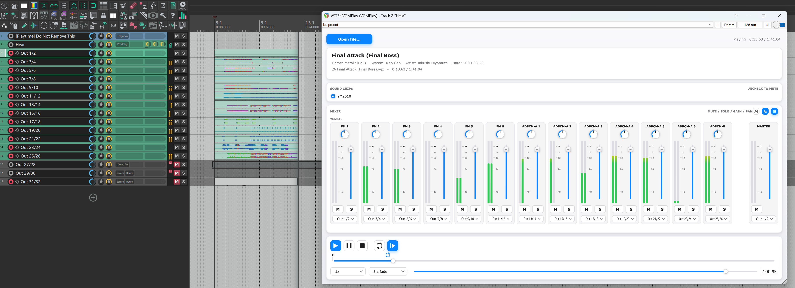

<h1 align="center">VGMToybox</h1>

<p align="center">
  
</p>

<p align="center"><a href="README.zh-CN.md">简体中文</a> | English</p>

A chiptune music player as a **VST3 / AU plugin** and a standalone application, built on
[libvgm](https://github.com/ValleyBell/libvgm.git). It reads `.vgm`, `.vgz`, `.s98`, `.dro` and `.gym`
(plus `.m3u` playlists), lists the chips a song uses, and gives every chip channel its own mixer strip.
Up to 64 stereo output buses let a song be recorded as stems in one pass.

## Building

The third-party libraries are vendored as source under `libs/`, so there are no submodules to fetch.
JUCE and zlib are fetched by CPM and pinned in `plugin/CMakeLists.txt`; zlib is compiled once for
`.vgz`.

### Windows

Visual Studio 2019/2022/2026 with the **Desktop development with C++** workload, CMake and Ninja
(the copy bundled with CMake is found automatically).

**MinGW will not work.** JUCE 8 and later support MSVC on Windows and nothing else, so this project
cannot be built with a MinGW toolchain either - the errors start inside JUCE's own sources, before the
compiler ever reaches ours.

```powershell
.\build.ps1
```

The script sets up the MSVC environment, configures with CMake + Ninja and copies everything into `dist\`:

| Artefact | What it is |
|---|---|
| `dist\VST3\VGMToybox.vst3` | the plugin |
| `dist\Standalone\VGMToybox.exe` | the same engine as a standalone application |
| `dist\AAX\VGMToybox.aaxplugin` | Pro Tools - unsigned, so developer builds only |

`-NoPlugin` skips the JUCE plugin and builds nothing else; `-Proxy <url>` / `-NoProxy` control how CPM reaches
GitHub. `-Clang` is a check instead of a build: when clang-cl is installed, every plugin source is run
through it with `/Zs` (syntax and type check only, no object files) on the same command line the MSVC
build used. It is there for the writing MSVC accepts and clang does not - a green Windows build and a
red macOS one is the failure it exists to catch - and without clang it prints one line and carries on.

The AAX bundle and the bus count are build-time constants, so they are set in the cache once, before
the first build:

```powershell
cmake -S . -B build -DTOYBOX_BUILD_AAX=OFF -DTOYBOX_OUTPUT_BUSES=16
.\build.ps1
```

### macOS

The Xcode command line tools, CMake and Ninja:

```bash
xcode-select --install
brew install cmake ninja
```

```bash
cmake -B build -G Ninja -DCMAKE_BUILD_TYPE=Release -DCMAKE_OSX_ARCHITECTURES="x86_64;arm64"
cmake --build build --parallel
```

Drop `CMAKE_OSX_ARCHITECTURES` for a native build; the universal one is for handing the bundle to
somebody else. The floor is **macOS 10.15**, and 11.0 for the arm64 half - `CMAKE_OSX_DEPLOYMENT_TARGET`
in `CMakeLists.txt` sets it, because left unsaid it follows the SDK of whatever machine builds it.

The bundles land in `build/plugin/VGMToybox_artefacts/Release/`: `VST3/VGMToybox.vst3`,
`AU/VGMToybox.component` and `Standalone/VGMToybox.app`.

### Linux

JUCE needs these headers before it builds at all, and ALSA at runtime:

```bash
sudo apt install ninja-build libasound2-dev libx11-dev libxext-dev libxinerama-dev \
  libxrandr-dev libxcursor-dev libfreetype6-dev libfontconfig1-dev libgl1-mesa-dev
```

```bash
cmake -B build -G Ninja -DCMAKE_BUILD_TYPE=Release
cmake --build build --parallel
```

The bundles land in `build/plugin/VGMToybox_artefacts/Release/`: `VST3/VGMToybox.vst3` and
`Standalone/VGMToybox`.

Build on the oldest distribution you care about - glibc is backwards compatible, so the version it
links against becomes the floor. The release packages come out of an `ubuntu:22.04` container for
exactly that reason.

### Tests

The console tests are `EXCLUDE_FROM_ALL`, so they are asked for by name, and `ctest` is the runner:

```bash
cmake --build build --target vgm_core_test vgm_ui_test vgm_app_test vgm_mixer_test
ctest --test-dir build --output-on-failure
```

`plugin/CMakeLists.txt` registers one test per program and one per window script (`app.<script>`,
from `plugin/Tests/scripts/`), with labels and timeouts, so `ctest -R app.` reruns just the window
scripts. `vgm_mixer_test` is the sample-exact one: it renders a real song twice, so its test only
exists when a song does - the repository ships `plugin/Tests/assets/minimal.vgm`, and
`-DTOYBOX_TEST_SONG=<file>` points it at a bigger one. On Windows `.\build.ps1 -Test` builds all
four programs and then runs exactly that list.

## Using it

### The standalone

`VGMToybox` plays the file it is started with, so anything that hands it one - a command line, a
shortcut, Explorer - loads it and starts the transport:

```powershell
.\dist\Standalone\VGMToybox.exe "C:\music\Some Song.vgm"
```

Its files live under `%APPDATA%\VGMToybox` (`~/Library/Application Support/VGMToybox` on macOS,
`~/.config/VGMToybox` on Linux): `settings.xml` holds the preferences shared with the plugin, and
`standalone-state.xml` holds the audio device, window position and last plugin state that only a
standalone has. An older `VGMToybox.settings` is moved to that name on first launch.

### Opening songs from Explorer

Associate the formats with the application once, through Windows' own dialog. **The program never
touches the registry** - no installer, no shell extension, no helper script - so the association is
yours to create, change and undo:

1. right-click a song and choose **Open with** → **Choose another app**;
2. pick `VGMToybox.exe` (*More apps* → *Look for another app on this PC* finds it the first time);
3. tick **Always use this app**, and repeat for `.vgz`, `.s98`, `.dro` and `.gym` if you want those too.

Windows keeps the choice per user, and *Settings* → *Apps* → *Default apps* is where it is edited -
deleting the folder removes all of it. Two things worth knowing: a recorded association stores a
path, so moving or replacing the executable breaks the double click (keep one copy and replace that
file when upgrading); and a launch that cannot use the song it was handed writes one line to
`%TEMP%\vgmtoybox-startup.log` - a launch that works writes nothing.

By default the song goes into the window that is already open: the running window replaces what it
is playing and comes to the front, and the second process exits without drawing anything. *Settings*
→ *General* → **Reuse the running window** turns that off, and then every double-click starts a
window of its own - which is what you want when two songs are meant to be compared.

- **macOS** never starts a second copy of a running application: the Finder hands the document to
  the one that is open, so there is nothing to switch and the page states the behaviour instead. The
  `.app` declares the five formats, so *Open With* offers it (unsigned, so the first launch needs
  *Open* from the context menu).
- **Linux** is not wired up - JUCE's cross-process hand-over has no implementation there - so the
  setting is not shown and every launch is its own process.
- A hand-over that could not be used leaves one line in `%TEMP%\vgmtoybox-second-instance.log`, in
  the same spirit as the startup log above.

### Closing to the system tray

*Settings* → *General* → **Keep running in the system tray** changes what the window's close
button does: the window disappears, the song keeps playing, and a VGMToybox icon stays in the
notification area. Left-click the icon to bring the window back; right-click it for Show Window,
Play/Pause, Stop, Loop, Fade and Quit. The context menu is the system menu on
Windows (Win32) and macOS (NSMenu); Linux falls back to JUCE's menu because its tray protocol has
no native menu to attach. Quit is the real exit and saves state through the same path a close
used to take. The option is off by default, so nothing changes
until you ask for it; the icon itself appears on the first close that the setting swallows.

On Linux a desktop without a notification area cannot show the icon, and JUCE's X11 backend
reports no failure to detect - the switch says so in red, and the feature is best-effort there.

### Changing the language

*Settings* → *Language* switches the window and its tooltips between the built-in English and
Simplified Chinese packs, and lists every translation file in `%APPDATA%\VGMToybox\i18n`
(`~/Library/Application Support/VGMToybox/i18n` on macOS, `~/.config/VGMToybox/i18n` on Linux).
**Open Folder** creates and reveals that folder; **Rescan** picks up files added or edited while
the window is open. A file whose `id:` matches a built-in language is offered as a separate choice
beside it, and the strings it leaves out fall back to that built-in pack and then to English - so a
translation can start with a handful of lines.

A file is UTF-8 and begins with two metadata lines; the keys are the ones the English pack uses
(the Language page says how many are still missing):

```text
language: 简体中文
id: zh-Hans

"menu.file.open" = "打开歌曲...";
"transport.play"  = "播放";
```

The plugin and the standalone share the folder and the stored choice.

### Changing the interface font

*Settings* → *Appearance* → **Font** shows the family the window is drawn with. **Choose...**
opens a picker that lists the installed system fonts and keeps **System UI** as the first row;
the search box filters the list and the two sample lines follow the highlighted row. The choice
is saved, and the page notes that the window has to be reopened (restart the standalone) because
JUCE has already laid out the current labels with the old face. If the saved family is no longer
installed, the window falls back to the system UI font and the row names the missing family.

### Pitch bend

Every fine pitch a chip produces - vibrato, slides, the detuning between channels - becomes MIDI pitch
bend, and a bend value only means something relative to the receiving instrument's bend range. MIDI has
no way to ask a synth for that range, so *Settings* → *MIDI* states it: 1 to 24 semitones each way, 12
by default. The engine declares it as RPN 0 on every channel it plays (the message a General MIDI synth
reads) and scales each bend by it.

**Send pitch bend** off drops bends altogether: notes land on their nearest semitone and no `0xE0` goes
out at all, for an instrument that ignores or misreads the wheel. The range row greys out but keeps its
value, so turning the switch back on restores what was there. Turning it off mid-song sends one centring
message to a channel this engine left off-centre, so the mode does not inherit the last vibrato as a
permanent detune.

### In a DAW

Copy the bundle into the plugin folder and rescan:

| | Plugin folder |
|---|---|
| Windows | `C:\Program Files\Common Files\VST3\` |
| macOS | `~/Library/Audio/Plug-Ins/VST3/` and `~/Library/Audio/Plug-Ins/Components/` |
| Linux | `~/.vst3/` |

If an older `VGMPlay.vst3` from this project is installed, delete it first: the plugin codes are
deliberately unchanged, so a host would see the two bundles as the same plugin.

### What a project keeps

Since 0.1.0 the plugin's state carries the song **as data**, not as a path: the file is embedded in
the project (compressed), so the project opens on a machine that never saw it, together with the
mixer settings, the per-track values and the routing. The transport is not part of it: a project
always opens **stopped at the top of the song**, so opening one never makes sound on its own. Two
limits are worth knowing:

- a song over 16 MB is not embedded - the project still restores every setting and the status line
  says the song has to be loaded again;
- projects saved with 0.0.5 or older used a different format (a path, no snapshot). This version
  refuses that format rather than guessing: the instance comes up empty and says so in the status
  line, and the song is loaded once more by hand.

### Recording stems into a DAW

The multi-output routing exists for one workflow: record every chip on its own track in a single pass
instead of soloing chips one by one.



1. **Enable the extra buses** for the plugin instance in the host. The plugin declares 64 stereo buses
   and only `Out 1/2` is active until you do - the same step Kontakt users know.
2. **Route the strips**: click *spread outputs* in the mixer header (track 1 → `Out 1/2`, track 2 →
   `Out 3/4`, …), then fix individual strips in their output selector where that does not fit - or
   send everything to the master bus and leave the routing alone.
3. **Arm one host track per bus and record.** Each chip channel lands on its own track, and the routing
   is remembered as the default for the next song you load.

Every strip is a separately rendered libvgm instance, so the stems add up to exactly the mix you would
have heard - `vgm_mixer_test` proves that sum is sample-exact.

### Mixer off

Runs libvgm's plain mix; its unity-gain sum is bit-identical to the mixer's.

## Licence

VGMToybox is distributed under the **GNU Affero General Public License v3.0 or later**
(AGPL-3.0-or-later); the full text is in [LICENSE](LICENSE).

The decisive reason is JUCE's dual-licensing policy. JUCE is available under the AGPLv3 or a
commercial JUCE licence; this project uses the AGPLv3 option, so the plugin and the standalone are
distributed under the AGPL as a combined work. A JUCE commercial licence would be needed for a
distribution under different terms.

### Upstream projects

VGMToybox builds on the following upstream projects. Their own licences apply to their code; this
table is an overview, not a replacement for the licence text in each source tree.

| Upstream | What it provides | Licence |
|---|---|---|
| [libvgm](https://github.com/ValleyBell/libvgm) | VGM/VGZ/S98/DRO/GYM decoding, chip emulation and playback | Per-file: BSD-3-Clause, GPL-2.0 / GPL-2.0-or-later, LGPL-2.1-or-later, MIT; see the file headers |
| [JUCE](https://github.com/juce-framework/JUCE) 8.0.9 | VST3/AU/AAX and standalone framework, UI and host integration | AGPLv3 or commercial; this project uses the AGPLv3 option |
| [nsfplay](https://bbbradsmith.github.io/nsfplay/) | NSF decoding: the 6502, the APU and DPCM, and the expansion chips | "You may reuse this code without restriction" (see `libs/nsfplay/README-nsfplay.txt`) |
| [inih](https://github.com/benhoyt/inih) | INI parser for configuration — **no longer built** | BSD-3-Clause |
| [wingetopt](https://github.com/alex85k/wingetopt) | getopt for the MSVC command-line build — **no longer built** | ISC, with a BSD-3-Clause part |
| [zlib](https://zlib.net/) 1.3.1 | DEFLATE for `.vgz` | zlib |
| [CPM.cmake](https://github.com/cpm-cmake/CPM.cmake) | build-only dependency manager; not shipped | MIT |

libvgm and nsfplay are vendored under `libs/` and built by the root `CMakeLists.txt`; JUCE and zlib
are fetched by CPM at configure time. The pinned JUCE version is `JUCE_TAG` in
`plugin/CMakeLists.txt`. inih and wingetopt are still on disk because their upstream revisions and
licences live with them, but nothing builds them any more — they served the command-line player,
which is gone.

## Subscribe

If you like it, subscribe here:

1. MIDIshow: <https://www.midishow.com/u/Silgm>
1. Bilibili: <https://space.bilibili.com/249486555>
